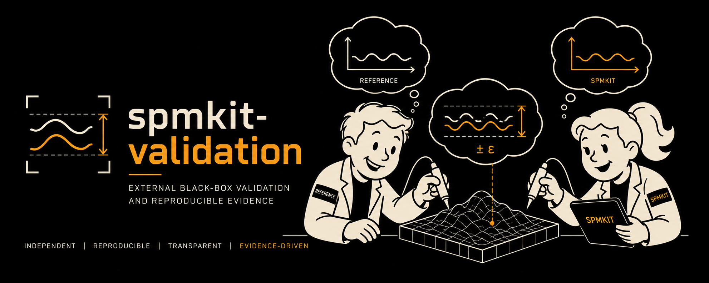

# SPM-Kit Validation

**An external, process-isolated validation harness and evidence archive for SPM-Kit.**

**José Labarca Baeza is the creator, author, and lead developer.** This repository
was developed independently and tests SPM-Kit through public command-line behavior
and retained artifacts; it does not import SPM-Kit internals to establish results.

[](https://github.com/kegouro/spmkit-validation/actions/workflows/ci.yml)
[](pyproject.toml)
[](LICENSE)

[English](README.md) · [Español](README.es.md) · [Campaign matrix](docs/CAMPAIGNS.md) · [Contributing](CONTRIBUTING.md)

## Why an external harness?

Internal tests are necessary, but they can share implementation details with
the code under test. The generic runner here constructs an argument vector,
invokes an installed `spmkit` executable with `subprocess.run`, captures
stdout/stderr and the exit code, and verifies declared output artifacts.

Campaign generation and reference materialization may use Phantoms or dedicated
reference adapters in the harness process. SPM-Kit itself remains on the
process boundary. Evidence created by older or specialized campaign code is
identified by its pinned commit, protocol, lock, and summary rather than being
presented as if every path used the current generic CLI.

## Current evidence

The table is generated from committed protocol, lock, design, result, and
summary files. See [docs/CAMPAIGNS.md](docs/CAMPAIGNS.md) for all fields and links.

| Campaign | SPM-Kit / reference | Data and metrics | Cases / outcome | Maturity | Reproduction and limitation |
|---|---|---|---|---|---|
| `gwyddion-roughness-48-v0.1` | SPM-Kit `5a704d6`; Gwyddion 2.71 | 48 canonical float32 matrices; Sa, Sq, Sz; no preprocessing | 48 cases, 144/144 within tolerance | `LEVEL 3 — CROSS_VALIDATED` | Evidence preserved; not physical validation or universal equivalence |
| `real-data-roughness-pilot-v0.1` | SPM-Kit `5a704d6`; Gwyddion 2.71 | 12 public experimental GWY records; Sa, Sq, Sz | 36/36 shared-matrix comparisons; 10 parser equivalences, 2 differences | `LEVEL 3` for the shared-matrix track | Parser and end-to-end tracks are observational; real data are not ground truth |
| `nanoscope-spm-parser-pilot-v0.1` | Limited SPM-Kit reader; Gwyddion 2.71 | Six demonstrated Nanoscope III files; matrices and Sa/Sq/Sz | 18/18 metrics within tolerance; zero reported pixel delta | `LEVEL 2 — NUMERICALLY_VERIFIED` | `AUDIT_PASS_WITH_LIMITATION`; `ACCIDENTAL_PRE_FREEZE_UNBLINDING`; partial, not a blind holdout |
| `gwyddion-cross-validation-v0.1` release milestone | SPM-Kit 0.1.4 wheel; isolated Gwyddion 2.71 libraries | Six synthetic full-field surfaces; Sa, Sq, Sz | 18/18 within tolerance | `LEVEL 3 — CROSS_VALIDATED` | Published tag; frozen wrapper contains Sa accumulation |

Because the confirmation records were exposed before the freeze, the Nanoscope audit
had no `archivos nuevos no observados`; its scope is closed without a blind-holdout claim.

Committed `smoke_v0.1.yaml` and `image_roughness_v0.1.yaml` are executable
campaign definitions. Their locally generated outputs are not promoted into
the evidence matrix unless a versioned result summary is committed.

## Maturity vocabulary

`LEVEL 0 — CLAIMED` → `LEVEL 1 — SOFTWARE_VERIFIED` →
`LEVEL 2 — NUMERICALLY_VERIFIED` → `LEVEL 3 — CROSS_VALIDATED` →
`LEVEL 4 — PHYSICALLY_VALIDATED` → `LEVEL 5 — REPRODUCIBILITY_VALIDATED`.

No campaign in this repository establishes a general `LEVEL 4` or `LEVEL 5`
claim. A level applies only to its named metric, dataset family, protocol,
software versions, and tolerance.

## Reproduce the executable harness

Create sibling checkouts so the smoke campaign can import Phantoms while invoking
an installed SPM-Kit executable:

```text
workspace/
├── spmkit/
├── spmkit-phantoms/
└── spmkit-validation/
```

```bash
cd spmkit-validation
python -m venv .venv
source .venv/bin/activate
python -m pip install -e .
python -m pip install -e ../spmkit-phantoms
python -m pip install -e ../spmkit

python -m pytest tests/ -q
spmkit-validation --help
```

Run the six-case smoke definition into an explicit result directory:

```bash
spmkit-validation campaign campaigns/smoke_v0.1.yaml results/smoke \
  --spmkit "$(command -v spmkit)"

spmkit-validation report \
  results/smoke/smoke_v0.1/cases.csv \
  results/smoke/smoke_v0.1
```

The 30-case definition is intentionally not a default:

```bash
spmkit-validation campaign campaigns/image_roughness_v0.1.yaml results/image_roughness \
  --spmkit "$(command -v spmkit)"
```

Campaign outputs are new scientific artifacts. Review disk location, SPM-Kit
identity, dependencies, and permissions before running. `make smoke` and
`make full-campaign` wrap the same definitions.

## Evidence layout

| Path | Purpose |
|---|---|
| `protocols/` | Frozen scientific contracts and preprocessing rules |
| `locks/` | Repository commits, software versions, hashes, and execution state |
| `campaigns/design/` | Ordered case definitions before execution |
| `evidence/campaigns/` | Result rows, summaries, and retained manifests |
| `docs/campaigns/` | Human-readable reports, audits, and incident limitations |
| `evidence/calibration/` | Accepted numerical threshold evidence |
| `src/spmkit_validation/runner.py` | Generic subprocess boundary |

Frozen evidence is append-only in practice: do not rewrite inputs, results,
thresholds, or hashes to make a campaign pass.

## Ecosystem

> **Find the evidence → define the truth → test the system externally → preserve the result.**

[Explore the complete ecosystem portal](https://kegouro.github.io/spmkit/ecosystem/)
for component boundaries, artifact contracts, installation paths, and reproducible
workflow tutorials.

- [SPM-Kit / Fathom](https://github.com/kegouro/spmkit) is the system under test.
- [SPM-Kit Phantoms](https://github.com/kegouro/spmkit-phantoms) provides known synthetic truth.
- [SPM-Kit Data Hunter](https://github.com/kegouro/spmkit-data-hunter) locates and triages public candidate evidence.
- This repository freezes contracts, invokes public interfaces, and preserves outcomes.

The projects are independent open-source work. Comparison or interoperability
does not imply endorsement by UTFSM, the SPM Lab, AFM-SPM, Gwyddion, AFMReader,
or TopoStats.

## Contributing

Useful contributions include new campaign proposals, independent comparisons,
redistributable reference datasets, and reproducibility failures. Every proposal
must declare reference independence, data rights, preprocessing, metrics,
tolerances, software versions, and known limitations. See [CONTRIBUTING.md](CONTRIBUTING.md).

## Citation

Use [CITATION.cff](CITATION.cff). José Labarca Baeza is the software author.
Dataset and laboratory acknowledgements do not create software co-authorship.

## Acknowledgements

Tomás Corrales and the SPM Lab at Universidad Técnica Federico Santa María provided selected experimental datasets and laboratory context during the development and evaluation of SPM-Kit.

María Saavedra Fredes and Benjamin Schleyer helped locate and share candidate datasets for the validation campaigns.

Candidate datasets still require scientific, legal, and technical review. These
acknowledgements do not imply that every located dataset was used, accepted,
redistributable, or scientifically suitable.

## Limits

- no general physical validation or independent reproducibility claim;
- no blind Nanoscope holdout;
- no universal equivalence with Gwyddion;
- proprietary reference environments may remain unavailable;
- public experimental data do not automatically provide ground truth;
- frozen campaign evidence covers only the named inputs, metrics, versions, and tolerances.

MIT License © 2026 José Labarca Baeza


## ValidationBundle lifecycle

La versión `0.1.1` incorpora operaciones black-box que no ejecutan campañas:

```bash
spmkit-validation bundle validate campaign-draft.json
spmkit-validation bundle verify-artifacts campaign-draft.json --artifact-root evidence-root
spmkit-validation bundle freeze campaign-draft.json \
  --artifact-root evidence-root --output-dir snapshots
spmkit-validation bundle verify-snapshot \
  snapshots/SHA256/bundle.json snapshots/SHA256/freeze-receipt.json
```

El contrato normativo sigue siendo `ValidationBundle 0.1.0`. Consulte
`docs/BUNDLE_LIFECYCLE.md` y `docs/ARTIFACT_VERIFICATION.md` para las garantías,
limitaciones, política de paths y exit codes. El gate completo no científico se
reproduce con `make phase01b-gates`.

## Synthetic campaign workflow

El paquete `0.1.2` ejecuta seis phantoms sintéticos congelados previamente,
siempre mediante el ejecutable instalado desde un wheel del SUT:

```bash
spmkit-validation campaign prepare-synthetic-roughness --output-dir CAMPAIGN
spmkit-validation bundle freeze CAMPAIGN/draft-bundle.json \
  --artifact-root CAMPAIGN --output-dir CAMPAIGN/protocol-snapshot
spmkit-validation campaign execute PROTOCOL/bundle.json PROTOCOL/freeze-receipt.json \
  --artifact-root CAMPAIGN --sut-wheel SPMKIT.whl --output-dir CAMPAIGN/execution
spmkit-validation campaign verify-result RESULT/result-bundle.json \
  RESULT/execution-receipt.json --protocol-bundle PROTOCOL/bundle.json \
  --protocol-receipt PROTOCOL/freeze-receipt.json --artifact-root CAMPAIGN
```

`make phase01c-gates` reproduce el flujo completo, incluida la repetición y
las pruebas de tampering. No usa datos instrumentales ni declara LEVEL 3+.

## Cumulative software and numerical workflow

El paquete `0.1.4` añade cross-validation headless contra bibliotecas Gwyddion y conserva
el protocolo acumulativo `0.1.3` con una suite de software exportada
por identidad Git y los seis casos sintéticos:

```bash
spmkit-validation campaign prepare-cumulative-verification \
  --output-dir CAMPAIGN --sut-repository ../spmkit-sanitize
spmkit-validation bundle freeze CAMPAIGN/draft-bundle.json \
  --artifact-root CAMPAIGN --output-dir CAMPAIGN/protocol-snapshot
spmkit-validation campaign execute-cumulative \
  PROTOCOL/bundle.json PROTOCOL/freeze-receipt.json \
  --artifact-root CAMPAIGN --sut-wheel SPMKIT.whl \
  --output-dir CAMPAIGN/execution
```

`make phase01d-gates` reproduce el workflow desde wheels y verifica JUnit,
claims acumulativos, repetición, continuidad y tampering.

### Gwyddion roughness cross-validation v0.1

Una campaña de validación externa congelada evaluó el wheel publicado de
SPMKit 0.1.4 frente a una instalación upstream verificada de las bibliotecas
Gwyddion 2.71. Se procesaron independientemente seis superficies sintéticas
`binary64` de campo completo mediante SPMKit y la ruta de referencia Gwyddion.
Sa, Sq y Sz produjeron 18/18 comparaciones cruzadas conformes, sin fallos,
errores ni resultados inconclusos.

La campaña respalda claims limitadas `LEVEL 3 CROSS_VALIDATED` para Sa, Sq y
Sz dentro de ese alcance sintético. La repetición fue numéricamente idéntica
para los 18 valores y outcomes; los tests negativos de independencia pasaron
8/8 y los tests de manipulación del protocolo pasaron 7/7.

| Evidence | Result |
| --- | ---: |
| SPMKit executions | 6 completed |
| Gwyddion executions | 6 completed |
| Sa/Sq/Sz comparisons | 18/18 PASS |
| Software checks | 12/12 PASS |
| Independence negative tests | 8/8 PASS |
| Tampering tests | 7/7 PASS |
| Repeatability | PASS |
| Claim level | LEVEL 3, limited scope |

La campaña no reclama validación física, datos reales, blind holdout, Level 5,
autenticidad criptográfica ni equivalencia universal con Gwyddion. La
referencia usa bibliotecas de Gwyddion mediante un wrapper congelado escrito
por el harness; la acumulación de Sa reside en ese wrapper. El bloqueo
histórico `BLOCKED_GWYDDION_REFERENCE_CONTRACT` se conserva como evidencia y
fue superado por `phase01e.install-and-resume.001`.

La evidencia canónica incluye el
[registro final de auditoría](evidence/phase01e-gwyddion/gate-results.json),
el [protocolo congelado](evidence/phase01e-gwyddion/protocol-snapshot/) y el
[snapshot de resultados](evidence/phase01e-gwyddion/result-snapshot/). El
cierre auditado permanece fijado en el
[commit canónico](https://github.com/kegouro/spmkit-validation/tree/2a3d6c780722a79cb19c079cec0476969267b10b)
y no constituye una release de SPMKit.

Reproducir:

```bash
make phase01e-gates
```

YAML campaigns require the independent Phantoms package: install with `pip install -e ".[campaign]"`.
